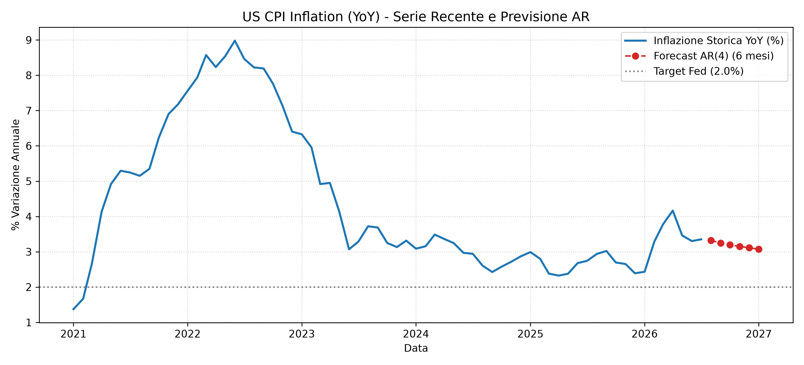

# 📈 US Macroeconomic Inflation Forecasting

Un progetto di analisi dati e time-series forecasting per prevedere l'andamento dell'inflazione USA a breve termine, utilizzando i dati ufficiali della Federal Reserve.

## 🎯 Executive Summary
L'obiettivo di questo progetto è costruire una pipeline automatizzata per scaricare, pulire e analizzare i dati macroeconomici (CPI). Ho implementato un modello econometrico **Autoregressivo AR(4)** in grado di catturare la persistenza dell'inflazione e proiettare la variazione percentuale anno su anno (YoY) per i successivi 6 mesi.

### Risultati del Modello


## 🛠️ Metodologia e Tecnologie
* **Data Source:** [FRED API](https://fred.stlouisfed.org/docs/api/api_key.html) (Federal Reserve Economic Data).
* **Data Ingestion:** Script automatico per estrarre la serie storica `CPIAUCSL` (dal 2000 in poi).
* **Econometria:** Modello `statsmodels.tsa.ar_model.AutoReg`. La scelta dei 4 ritardi (lag) permette di catturare l'inerzia trimestrale dei prezzi.
* **Stack Tecnologico:** Python, `pandas`, `statsmodels`, `matplotlib`, `fredapi`.

## 🚀 Come riprodurre il progetto in locale

1. Clona il repository:
   ```bash
   git clone [https://github.com/TUO-USERNAME/macro-inflation-forecasting.git](https://github.com/TUO-USERNAME/macro-inflation-forecasting.git)